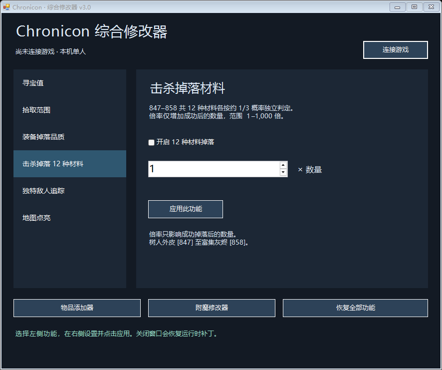

# Chronicon 综合修改器 v3.0

Windows x64 单人游戏工具，支持寻宝值、拾取范围、随机装备品质、独特敌人追踪、地图点亮、物品添加与附魔预选。

## 使用

1. [下载 v3.0 发布包](https://github.com/mayuzumi-git/chronicon-trainer/raw/refs/heads/main/dist/Chronicon-Trainer-v3.0.zip) 并解压，运行 `Chronicon修改器.exe`；也可使用仓库 `bin` 下的程序。
2. 启动游戏并进入角色，点击「连接游戏」。
3. 在左侧选择功能，在右侧设置开关与数值并应用。游戏暂停时，主线程请求会等待，请切回游戏。
4. 正常退出工具会恢复运行时补丁。已获得物品和已探索地图由游戏正常保存。

## v3.0

- 主窗口采用左侧功能列表、右侧独立设置；物品与附魔保留独立入口。
- 击杀敌人时，对 847–858 共 12 种材料各作一次约 1/3 概率判定；数量倍率 1–1,000，成功后在死亡位置生成一份材料堆。
- 装备增加 23 种法器，排除法典 [731]。
- 物品分类保留独立水晶 [0] 入口，移除货币／代币大类；空白符文石与掉落次级符文合并。



## 构建

需要 Windows 自带的 .NET Framework x64 C# 编译器。在 PowerShell 中运行：

```powershell
powershell -NoProfile -ExecutionPolicy Bypass -File .\src\build.ps1
```

生成程序位于 `src/Chronicon修改器.exe`。源码中的原生指令配置已包含在仓库，构建无需 Python 或游戏文件。

## 适配版本

本工具绑定已分析的游戏 EXE，SHA-256：

```text
ab163214859c2fb4dad2a433ea937ca9a8ee8d2b99d2a856b74310723d24800c
```

游戏更新后如哈希不符，工具会停止写入，需要重新适配。完整操作和验证范围见 [使用说明](docs/使用说明.md) 与 [v3.0 功能与验证说明](docs/v3.0功能与验证说明.md)。

本项目上传内容仅包含修改器、源码、说明、界面图片和测试源码，不包含游戏程序、存档、备份或个人装备快照。